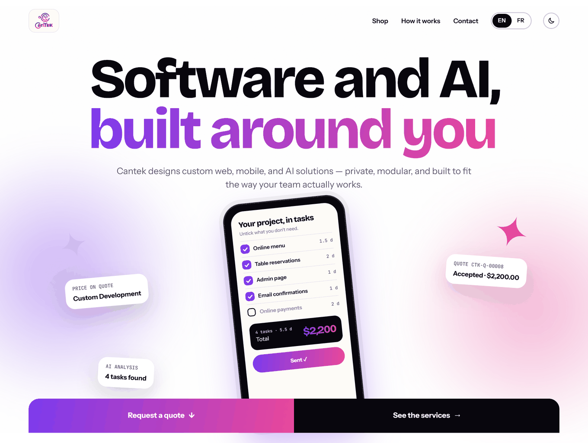
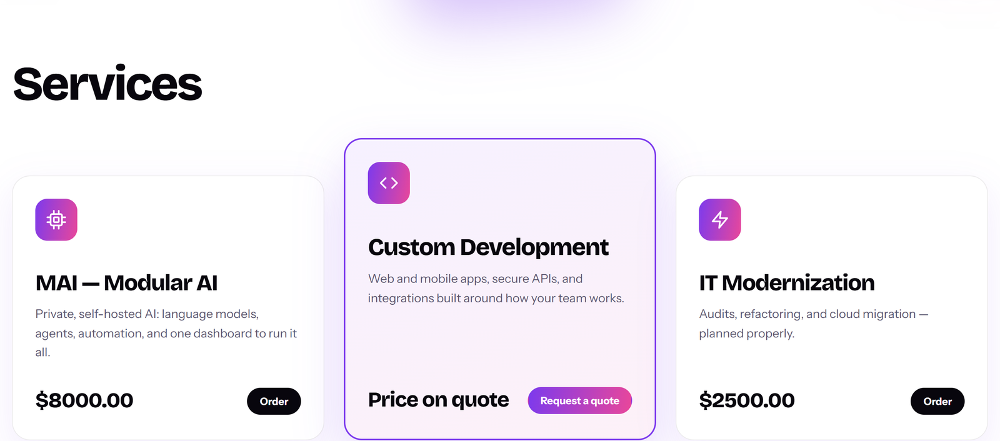
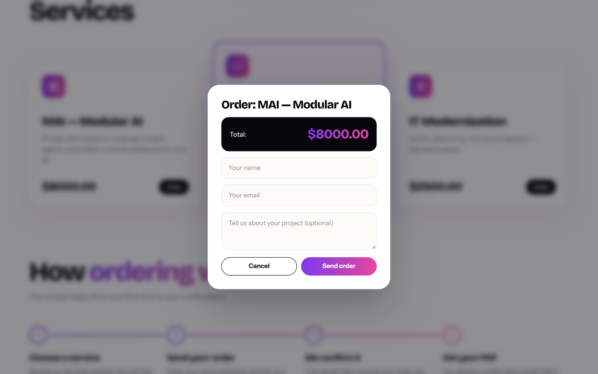
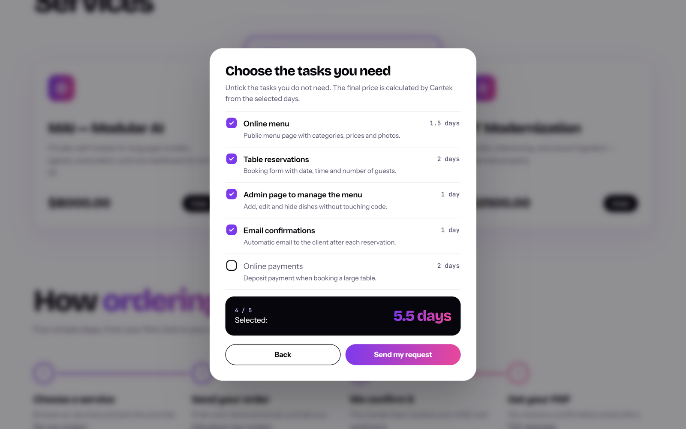
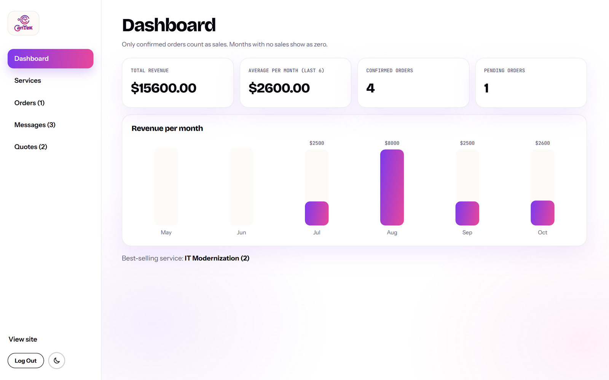
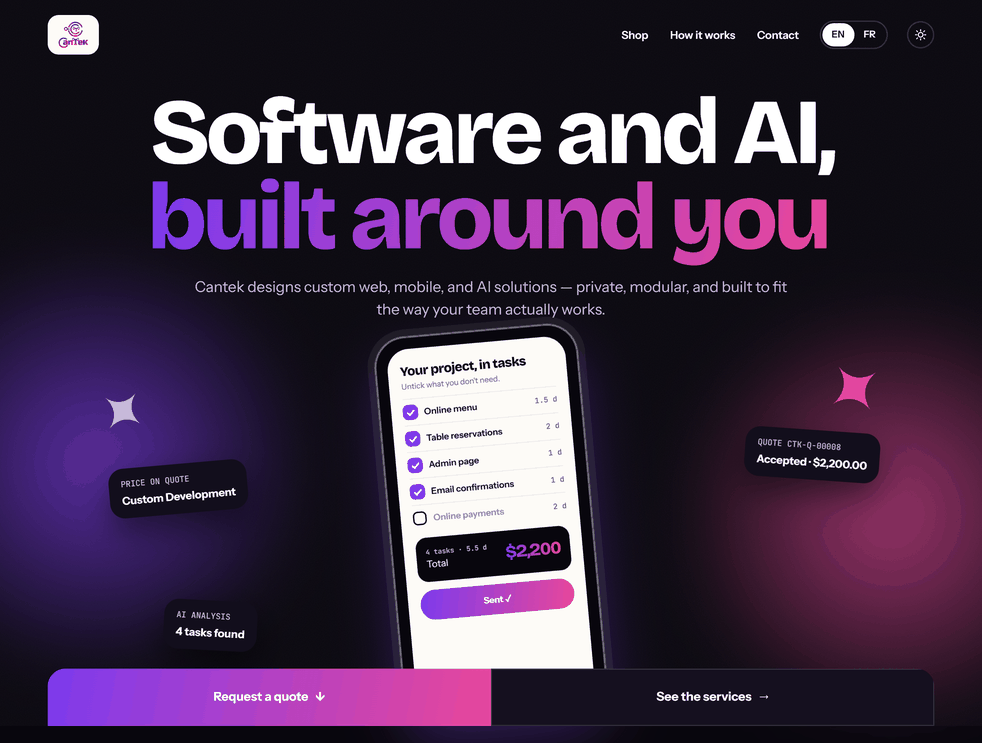
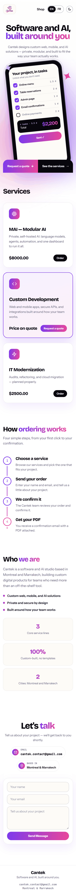

# Cantek – Business Website & Admin Platform

A full-stack business website and admin platform for **Cantek**, a software and AI studio. Clients can browse services, place orders, and request custom quotes. The Cantek team manages everything from a private admin panel.

This is a real project I built during my internship at **CANADA SOFT / Cantek**. It is published here with the company's permission.



## Features

- **Product and service shop** with fixed-price services and "price on quote" services
- **Online ordering**: clients order a service and get an email confirmation with a PDF attached once the order is confirmed
- **AI-assisted quote requests**: the client describes their project, Google Gemini splits it into tasks with day estimates, and the client unticks what they don't need
- **Quote acceptance by email link**: the admin sends a priced quote, and the client accepts it with a secure link from the email
- **Admin panel** to manage orders, quotes, contact messages and services, plus a revenue dashboard
- **EN / FR** language switch
- **Light / dark mode**
- **Responsive** layout, from phone width to desktop

## Tech stack

| Layer    | Technologies |
|----------|--------------|
| Frontend | React, TypeScript, Vite |
| Backend  | FastAPI, SQLAlchemy, Pydantic |
| Database | PostgreSQL |
| Auth     | JWT (python-jose), bcrypt password hashing |
| Email    | SMTP (order confirmations, quotes, password reset) |
| PDF      | ReportLab |
| AI       | Google Gemini API |
| Tests    | pytest, httpx (FastAPI TestClient) |

## Screenshots

| Services | Order form |
|----------|------------|
|  |  |

| AI quote checklist | Admin dashboard |
|--------------------|-----------------|
|  |  |

| Dark mode | Phone width |
|-----------|-------------|
|  |  |

## Project structure

```
backend/    FastAPI app (API, models, auth, email, PDF, Gemini integration, tests)
frontend/   React + TypeScript single-page app (shop, admin panel, quote acceptance)
docs/       Screenshots
start-app.bat   Windows helper that starts backend and frontend together
```

## Getting started

### Requirements

- Python 3.11+
- Node.js 20+
- PostgreSQL
- An SMTP account (for example Gmail with an app password)
- A Google Gemini API key (for AI-assisted quotes)

### Backend

```bash
cd backend
python -m venv venv

# Windows
venv\Scripts\activate
# macOS / Linux
source venv/bin/activate

pip install -r requirements.txt
```

Copy the example environment file and fill in your own values:

```bash
# Windows
copy .env.example .env
# macOS / Linux
cp .env.example .env
```

| Variable | Description |
|----------|-------------|
| `DATABASE_URL` | PostgreSQL connection string |
| `ADMIN_EMAILS` | Comma-separated emails that get admin rights |
| `SMTP_HOST`, `SMTP_PORT`, `SMTP_USER`, `SMTP_PASSWORD` | SMTP server used to send emails |
| `SECRET_KEY` | Long random string used to sign JWT tokens |
| `GEMINI_API_KEY`, `GEMINI_MODEL` | Google Gemini settings |
| `FRONTEND_URL` | Public URL of the frontend, used in email links |

Create the database in PostgreSQL, then start the API (tables are created on startup):

```bash
uvicorn main:app --reload
```

The API runs at http://127.0.0.1:8000 and the interactive docs at http://127.0.0.1:8000/docs.

### Frontend

```bash
cd frontend
npm install
npm run dev
```

The site runs at http://localhost:5173.

On Windows you can also double-click `start-app.bat` to start both servers once the setup above is done.

## Running tests

The backend tests use an in-memory SQLite database and fake keys, so they don't need PostgreSQL, SMTP or Gemini:

```bash
cd backend
pytest
```

## Author

**Mohamed Ilias Lamtaouab**
